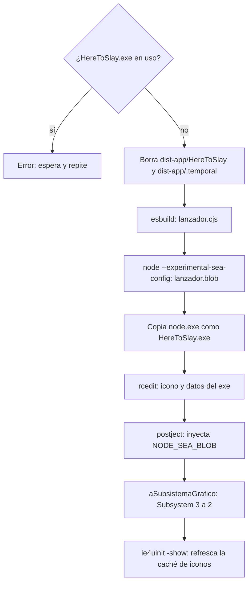

# Ejecutable de escritorio (`HereToSlay.exe`)

**Resumen.** `pnpm empaquetar` genera `dist-app/HereToSlay/HereToSlay.exe`, un **lanzador**: al
hacer doble clic abre en el navegador el juego desplegado en Render (`URL_EN_LINEA`,
[DESPLIEGUE.md](DESPLIEGUE.md)) y termina. No arranca ningún servidor, no pregunta nada y no
muestra ventana de consola (está marcado como aplicación gráfica de Windows). Para jugar con un
servidor en este equipo (misma Wi-Fi o sin internet) se usa `pnpm servidor`
([EN_LINEA.md](EN_LINEA.md)). La carpeta `dist-app/HereToSlay/` contiene **solo** `HereToSlay.exe`.

Código: `apps/server/src/escritorio.ts` (el lanzador), `apps/server/src/principal-escritorio.ts`
(punto de entrada), `apps/server/scripts/empaquetar.ts` (empaquetado),
`apps/server/scripts/subsistema.ts` (subsistema PE) y `apps/server/scripts/icono.ts` (icono).
Tests: `apps/server/test/escritorio.test.ts` e `icono.test.ts`.

## Requisitos

- Haber instalado los recursos (`pnpm recursos`): el icono sale de `assets/cartas/logo.png`. Sin él
  el script avisa y el ejecutable lleva el icono de Node.
- Node ≥ 20.12 (el de `engines` en `package.json`). El ejecutable copia **el Node con el que se
  ejecuta el script**, así que pesa unos 90 MB.
- Pensado para Windows. En macOS y Linux el script genera `HereToSlay` (sin `.exe`, y en macOS con
  el segmento `NODE_SEA`), pero sin icono ni subsistema gráfico.

## Qué hace el lanzador

`principal-escritorio.ts` llama a `principal()` (`escritorio.ts`) y, cuando termina, `process.exit(0)`.
`principal()` solo ejecuta `abrirNavegador(URL_EN_LINEA)`:

| Plataforma | Orden (`ordenNavegador`)                     |
| ---------- | -------------------------------------------- |
| Windows    | `rundll32 url.dll,FileProtocolHandler <url>` |
| macOS      | `open <url>`                                 |
| Linux      | `xdg-open <url>`                             |

La orden se lanza desacoplada (`detached`, `stdio: 'ignore'`, `windowsHide`) y la promesa se
resuelve en cuanto el proceso arranca. Si la orden falla no hay a quién avisar (no hay consola): el
lanzador simplemente termina. Render pide la contraseña al entrar y, en el plan gratuito, el primer
acceso tras un rato inactivo tarda en cargar.

## Subsistema gráfico (apartado técnico)

`node.exe`, y por tanto el ejecutable SEA, es una aplicación de **consola**: Windows le abriría una
ventana negra al hacer doble clic. La cabecera PE de todo ejecutable de Windows tiene un campo
**Subsystem** que indica cómo se ejecuta: `3` (`WINDOWS_CUI`, consola) o `2` (`WINDOWS_GUI`,
gráfico). `aSubsistemaGrafico` (`scripts/subsistema.ts`) lo cambia de 3 a 2 en una copia del búfer:

1. En el desplazamiento `0x3C` del archivo está la posición de la cabecera `PE\0\0`.
2. Tras ella van 4 bytes de firma, 20 de cabecera COFF y la cabecera opcional; el campo Subsystem
   (2 bytes, little endian) está en el byte 68 de la cabecera opcional, igual en PE32 y PE32+.
   `posicionSubsistema` devuelve `pe + 24 + 68`.
3. Si falta la firma `MZ` o `PE\0\0`, lanza un error (no es un ejecutable de Windows).

Se aplica **después** de inyectar el código con postject, y solo en Windows.

## Qué hace `pnpm empaquetar`

El script raíz es `pnpm --filter @hts/server empaquetar`: **ya no compila la web** (`pnpm build`),
porque el ejecutable no lleva ni web ni cartas.



1. **Protección con el exe en uso.** Intenta abrir `HereToSlay.exe` en escritura; si Windows no lo
   permite, el script se detiene antes de borrar nada con «está en uso».
2. **Limpieza.** Borra y recrea `dist-app/HereToSlay/` (así desaparecen también `web/` y
   `cartas.es.json` de versiones anteriores) y la carpeta de trabajo `dist-app/.temporal/`.
3. **esbuild.** Empaqueta `src/principal-escritorio.ts` en **un único archivo CommonJS** minificado
   (`lanzador.cjs`), que es lo único que admite SEA.
4. **Blob SEA.** Escribe `sea-config.json` y ejecuta `node --experimental-sea-config`, que produce
   `lanzador.blob`.
5. **Copia de Node e icono (solo Windows).** Copia `process.execPath` como `HereToSlay.exe`. Antes
   de inyectar el código (porque `rcedit` reescribe los recursos), `iconoDesdeLogo`
   (`scripts/icono.ts`) toma `assets/cartas/logo.png` (`IMAGEN_LOGO` de `@hts/cards`) y genera un
   PNG de 256 × 256 (`LADO_ICONO`): recorta el margen transparente (`cajaVisible`), lo escala con
   supermuestreo 3 × 3 y lo coloca sobre un cuadrado redondeado oscuro (el logo es texto claro con
   mucho margen y apenas se vería). `png-to-ico` lo convierte en `.ico` y `rcedit` lo aplica junto con
   `ProductName`/`FileDescription` («Here to Slay»).
6. **postject.** Inyecta el blob como `NODE_SEA_BLOB` y activa el fusible `NODE_SEA_FUSE_…`, que
   hace que Node arranque ese código en lugar de comportarse como `node`.
7. **Subsistema gráfico** (solo Windows): ver el apartado anterior. Después borra `.temporal/`.
8. **Caché de iconos** (solo Windows): `ie4uinit.exe -show`, para que el Explorador olvide el
   icono anterior. Si falla, solo avisa.

## Qué contiene `dist-app/HereToSlay/`

```
dist-app/HereToSlay/
└── HereToSlay.exe     Node + el lanzador (SEA), con el icono del juego, sin consola
```

Se puede copiar a cualquier equipo con Windows y internet, sin Node ni pnpm. **No se versiona**
(`dist-app/` está en `.gitignore`); ya no contiene arte ni textos de cartas, pero el icono se
construye con el logo, que es un recurso personal.

## Si cambia la dirección de Render

La dirección va escrita en el código a propósito: `URL_EN_LINEA` en
`apps/server/src/escritorio.ts`. Si el servicio de Render cambia de dirección
([DESPLIEGUE.md](DESPLIEGUE.md)), cambia esa constante y ejecuta `pnpm empaquetar`: el `.exe` ya
generado seguirá abriendo la dirección antigua.

## Problemas habituales

| Problema                                      | Causa y solución                                                                                                                                                                                      |
| --------------------------------------------- | ----------------------------------------------------------------------------------------------------------------------------------------------------------------------------------------------------- |
| Tarda ~30 s en abrirse la primera vez         | Tras cada `pnpm empaquetar`, el antivirus analiza un ejecutable nuevo de unos 90 MB sin firmar. Es normal: después tarda alrededor de 1 s. No lo abras varias veces seguidas, espera.                 |
| "Windows protegió su PC" (SmartScreen)        | El ejecutable no está firmado. Pulsa **Más información → Ejecutar de todas formas**. Suele salir la primera vez (y tras regenerarlo).                                                                 |
| Sigue saliendo el icono de Node o el antiguo  | La caché de iconos del Explorador. `pnpm empaquetar` la refresca con `ie4uinit -show`; si no basta, cierra sesión o reinicia el Explorador. Sin `pnpm recursos` no hay logo: sale el de Node.         |
| `HereToSlay.exe está en uso…` al empaquetar   | El ejecutable sigue abierto (o el antivirus lo está analizando). Espera a que termine y vuelve a ejecutar `pnpm empaquetar`.                                                                          |
| No se abre el navegador                       | No hay navegador predeterminado, o falló la orden del sistema (el lanzador no muestra errores). Abre a mano la dirección de `URL_EN_LINEA`; comprueba también el navegador predeterminado de Windows. |
| Abre una dirección que ya no funciona         | Cambió la dirección de Render: ver la sección anterior.                                                                                                                                               |
| Quiero jugar sin internet o en la misma Wi-Fi | El `.exe` no arranca servidor: usa `pnpm servidor` ([EN_LINEA.md](EN_LINEA.md)).                                                                                                                      |

Para jugar por internet con túnel de Cloudflare o invitar, ver [EN_LINEA.md](EN_LINEA.md).
